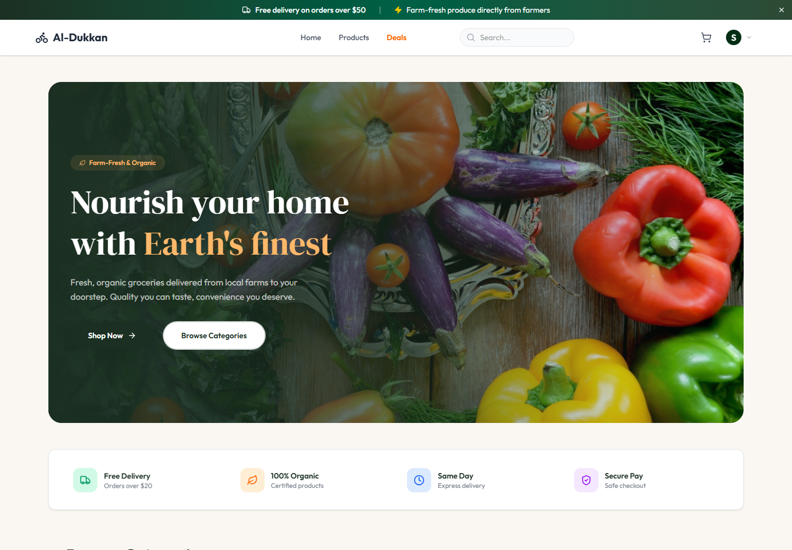
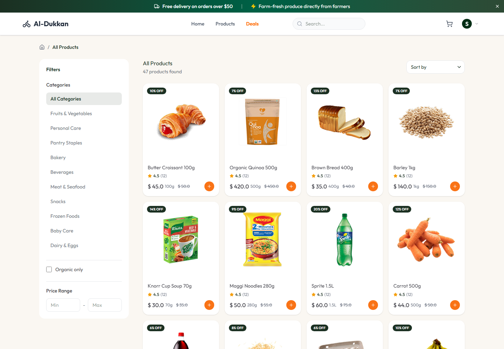
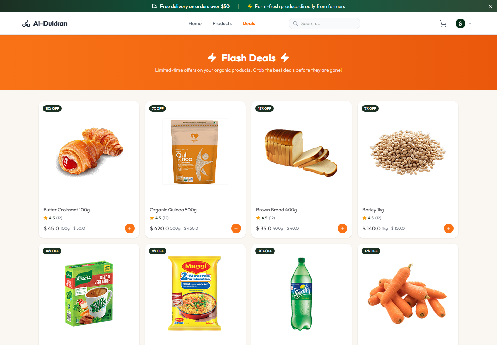

# Al-Dukkan - Grocery Delivery

A modern, responsive grocery delivery web application built with **React**, **Vite**, and **Tailwind CSS**. Al-Dukkan lets customers browse fresh products by category, search, filter, manage a cart, check out, and track their orders.

> This is a frontend-only implementation. Product data and authentication are currently mocked, so no backend is required to run the app.

## Screenshots

### Home



### Products



### Flash Deals



## Features

- Category browsing and a featured products landing page
- Product listing with filters (category, organic, price range), sorting, and pagination
- Product detail pages
- Search with dedicated results page
- Flash deals page
- Shopping cart sidebar with `localStorage` persistence, quantity updates, and totals
- Checkout and saved delivery addresses
- Order history and real-time-style order tracking with a Leaflet map
- Login / registration UI (mock authentication)
- Responsive design for mobile, tablet, and desktop
- Smooth animations with Framer Motion and toast notifications

## Tech Stack

| Category | Technology |
| --- | --- |
| Framework | React 19 |
| Build Tool | Vite 8 |
| Routing | React Router DOM 7 |
| Styling | Tailwind CSS 4 |
| Animations | Framer Motion |
| Icons | Lucide React, Heroicons, React Simple Icons |
| Maps | Leaflet, React Leaflet |
| Notifications | React Hot Toast |
| Linting | ESLint |

## Project Structure

```
.
├── client/                  # React application
│   ├── public/              # Static assets (favicon, icons)
│   ├── src/
│   │   ├── assets/          # Images, icons, and dummy data
│   │   ├── components/      # Reusable UI components
│   │   │   └── Home/        # Home page sections
│   │   ├── context/         # Cart context/provider
│   │   ├── pages/           # Route-level pages
│   │   ├── types/           # Shared TypeScript interfaces
│   │   ├── App.jsx          # Routes and layout
│   │   ├── main.jsx         # App entry point
│   │   └── index.css        # Global styles and theme
│   ├── index.html
│   ├── vite.config.js
│   └── vercel.json          # SPA rewrites for Vercel
├── grocery-assets/          # Design assets
└── package.json
```

## Getting Started

### Prerequisites

- [Node.js](https://nodejs.org/) 20.19+ (or 22.12+)
- npm

### Installation

```bash
git clone https://github.com/Saam22/Al-Dukan---Grocery-Delivery.git
cd Al-Dukan---Grocery-Delivery/client
npm install
```

### Environment Variables

Create a `client/.env` file with:

```env
VITE_CURRENCY_SYMBOL="$"
```

### Run Locally

```bash
npm run dev
```

The app will be available at `http://localhost:5173`.

### Build for Production

```bash
npm run build
npm run preview
```

### Lint

```bash
npm run lint
```

## Routes

| Path | Description |
| --- | --- |
| `/` | Home page |
| `/products` | All products with filters and sorting |
| `/products/:id` | Product detail page |
| `/search` | Search results |
| `/deals` | Flash deals |
| `/checkout` | Checkout |
| `/myorders` | Order history |
| `/myorders/:id` | Order tracking |
| `/addresses` | Saved addresses |
| `/login` | Sign in / sign up |

## Notes

- Cart contents are persisted in the browser via `localStorage`.
- Product and category data live in `client/src/assets/assets.ts`.
- Login and registration are simulated; no real authentication or API calls are made.
- The app is configured for SPA deployment on Vercel via `client/vercel.json`.
